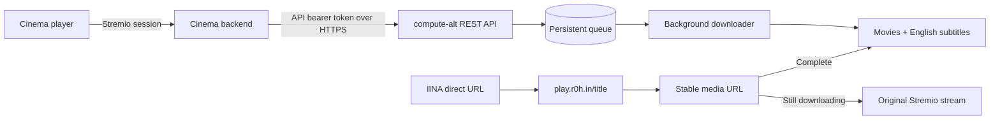

# Compute-alt downloads and playback

Cinema queues the selected stream and an English subtitle through an authenticated
REST API on `compute-alt.r0h.in`. Files live in `/home/ubuntu/Movies`; queue state
lives in `/home/ubuntu/.local/state/cinema-downloads/jobs.sqlite`. The systemd
service runs as `ubuntu`, resumes queued/interrupted work after a restart, and
processes one download at a time. The backend API token is in
`/etc/cinema-downloads.env` (root-readable) and Fly secrets, never in the browser.



## Playback

- `https://play.r0h.in/odysey` fuzzy-matches a title in the saved/queued library.
  It redirects to a stable `/media/<id>/video` URL and streams bytes directly.
- `https://play.r0h.in/odyssey-1997` selects a particular release year.
- `https://play.r0h.in/odysey/subtitles` serves the matching English subtitle.
- Completed media supports GET, HEAD, ETags and single HTTP byte ranges, including
  open-ended and suffix ranges. Files copied directly into Movies are included.
- Before completion, requests are proxied to the stored original stream with the
  client's Range header. This supports seeking to bytes not downloaded locally.
  Each new request uses the local file once complete. Active responses finish
  against the source they started with. Original cookies/auth headers are not
  exposed to clients.
- Playback URLs require no login, as required for direct IINA playback; download
  creation and administrative endpoints require authentication. The root page
  shows a live public library and download progress. Only files under Movies can
  be served.

Matching uses RapidFuzz edit/transposition, whole-title, token-order and partial
similarity. It normalizes articles, punctuation, accents, number words and Roman
numerals, penalizes extra title words and wrong sequel numbers, and uses explicit
years to disambiguate remakes. When the title score is identical, the newest year
wins, then a complete copy. Low-confidence queries return 404. Matching searches
the local/queued library; it does not search Stremio for movies you haven't saved.

The initial download implementation supports direct HTTP media. An HLS playlist
is rejected rather than saved as a movie. Original source URLs may expire; an
unfinished movie depends on that source remaining available. Subtitles keep
SRT/VTT/ASS format, are normalized to UTF-8, and SRT/VTT playback delays are applied.
ASS with a nonzero delay is rejected. An English subtitle is required to queue.

## REST API

All endpoints below require `Authorization: Bearer <CINEMA_DOWNLOAD_TOKEN>`:

- `GET /health`
- `POST /downloads` with `{title, videoUrl, subtitleUrl, subtitleDelay?, filename?}`
- `GET /downloads/<id>` returns queued/downloading/complete/failed and saved bytes.
- `GET /resolve/<query>` returns the top five title scores for diagnosis.

Public `GET /` serves the live movie shelf; `GET /library` supplies titles,
progress and playback/subtitle links. Source URLs, filesystem paths, and tokens
are excluded from this public response.

Cinema exposes `/ui/downloads` and `/ui/downloads/<id>` through its own backend.
It verifies the browser's Stremio session using `getUser` and an account email
allowlist. It then sends the separate server API token to compute-alt. Configure
`CINEMA_DOWNLOAD_API`, `CINEMA_DOWNLOAD_TOKEN`, and `CINEMA_DOWNLOAD_USERS` as Fly
secrets. The last variable is a comma-separated list of permitted Stremio emails.

Downloads and source proxies reject private/reserved IP addresses, including on
redirects. Connections pin the validated public address while retaining HTTPS
hostname verification. Completed files have matching video and `.en.srt`/`.en.vtt`
names. A short job suffix distinguishes different releases and avoids overwrites.

## Operations

The server utility now lives in [reelish](https://github.com/r0hin/reelish).
`remote/requirements.txt` pins the tested source commit; Cinema keeps the REST
integration and deployment configuration here.

The deployed service is `/etc/systemd/system/cinema-downloads.service`, with a pinned reelish installed into
`/home/ubuntu/.local/share/cinema-venv`. Nginx terminates TLS for both hostnames,
disables proxy buffering for immediate streaming, and rate-limits incoming requests.
Certbot's systemd timer renews the certificate. Ports 80/443 are allowed in the
server's persistent iptables configuration.

To install dependencies on another Ubuntu host, create a Python 3.8+ virtualenv
and install `remote/requirements.txt`. Adapt the supplied
service paths/user and nginx configuration before installing. Create Movies and
the state folder, write a random 32+ character API token into the environment file,
and enable the service. The supplied nginx configuration is the pre-TLS template;
Certbot adds the certificate and HTTPS redirect.

Useful commands:

```sh
ssh ubuntu@compute-alt.r0h.in 'sudo systemctl status cinema-downloads'
ssh ubuntu@compute-alt.r0h.in 'sudo journalctl -u cinema-downloads -n 30'
ssh ubuntu@compute-alt.r0h.in 'df -h /home/ubuntu/Movies'
```

Local validation:

```sh
pnpm build
pnpm test
python3 -m venv /tmp/cinema-test-venv
/tmp/cinema-test-venv/bin/pip install -r remote/requirements.txt
/tmp/cinema-test-venv/bin/python -m unittest discover -s test -p 'test_*.py' -v
```

The Python suite covers typo/remake/sequel matching, queue recovery, subtitle
delays, local ranges/HEAD, incomplete-source proxying, transition to local bytes,
manual library files, authentication, and private-address/path restrictions.

The existing `CINEMA_MOVIES`, `CINEMA_STATE`, and `CINEMA_DOWNLOAD_TOKEN` environment
variables remain supported by reelish, so the media library and queue database
are preserved. New installations can use the `REELISH_*` settings documented there.
